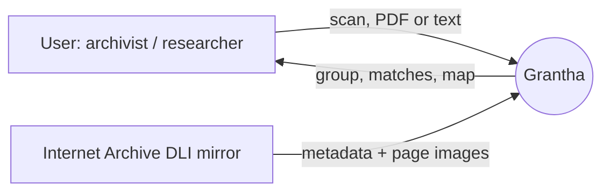
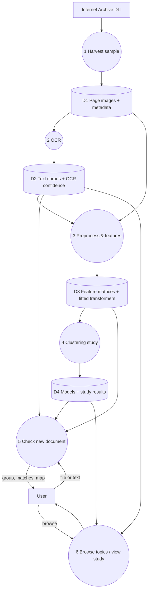

# Grantha (formerly Heritage Topic Finder): final plan

SIH26096, "An Unsupervised Grouping Study of Heritage Documents by Topic" (also titled "Heritage Document Theme Discovery Through Unsupervised Text Clustering"). CO2, CO3. Unit III & IV: Hierarchical & Density Clustering, PCA Visualisation.

Plan finalised 2026-11-08.

---

## 1. The problem and the use case

Old scanned books in Indian archives have no topic labels, so each one is read in isolation instead of next to its closest matches.

The web app serves archivists, librarians and researchers who hold an unindexed scan:

- **Input:** a page image, a PDF (first pages) or pasted text, in any of the 8 supported languages.
- **Output:** the topic group it belongs to (or a plain "no close group" when DBSCAN calls it noise), a confidence level, the 5 most similar archive documents with links to their original scans, the shared terms behind the match, and its position on the PCA map.
- **Browse:** every topic group with its top terms, typical documents and language mix.
- **Study:** every result the brief asks for, in one page with collapsible panels.

No retraining happens when a new document is checked.

---

## 2. Dataset

### Source
The **Digital Library of India (DLI) mirror on the Internet Archive** (collection `digitallibraryindia`). NDLI is mainly a metadata aggregator with no public bulk API; the DLI scans are the files behind many NDLI records. Public, no key.

Checked on 2026-11-08:
- 578,536 items; about 342,000 dated 1800–1950; about 22% have no date.
- Language codes per item: English 266k, Sanskrit 54k, Hindi 53k, Gujarati 39k, Bengali 37k, Urdu 33k, Telugu 18k, Kannada 6.6k, Tamil 5.8k, Marathi 4.2k.
- Single pages download on their own (`/download/<id>/page/n<k>_w1200.jpg`, about 420 KB). Whole PDFs (200 MB–1 GB) are never downloaded.
- Some descriptions carry a real classification (`dc.subject.classification`, e.g. "Law → Hindu Law"). Share to be measured during harvest.
- The archive's own OCR (`_djvu.txt`) exists for many items. Used only to check our OCR quality.

### Sample
- **3,000 documents**: about 375 each in English, Hindi, Sanskrit, Bengali, Gujarati, Telugu, Kannada, Tamil. Urdu left out (Tesseract reads its script poorly).
- Stratified by decade so no era dominates.
- **5 body pages per book**, at about 15/30/50/70/85% through, skipping covers, contents and indexes. About 15,000 page images (~6 GB), deleted after OCR.
- About 1 request per second, cached and resumable. Harvest takes 4–5 hours.

### Pilot first
50 documents per language before the full harvest. If a language's OCR is unusable (judged by Tesseract confidence and character agreement with the archive's own OCR), we stop and decide together whether to drop it.

### Known data problems and how they are handled
| Problem | Handling |
|---|---|
| The `subject` field holds the scanning centre ("Banasthali", "IIIT", "UOD"), not a topic | Excluded from features; tested separately for leakage through scan quality |
| Some language tags are wrong (e.g. Zimmer's English book tagged Sanskrit) | Script detected from OCR text; mismatch rate reported |
| No real topic labels | Classifications, where present, used only as a weak outside check after clustering, never as input |
| These are printed books, not handwritten manuscripts | Stated in report and app; handwriting recognition listed as future work |
| Rights marked "Not Available" | Only OCR text, metadata and links kept; no scans redistributed, including in the Docker image |

---

## 3. ML pipeline (mapped to the brief)

### 3.1 OCR and preprocessing
- Tesseract 5 in Docker with packs `eng hin san ben guj tel kan tam`. Per-page confidence kept.
- Text cleaning: Unicode normalisation (NFC), remove OCR junk (lines of symbols, page numbers, running heads), per-language stopwords, minimum length filter.
- Variable relevance review: drop near-constant and mostly-missing fields; drop the scanning-centre field (leakage).
- **Missing values:** year imputed by median with a `year_missing` flag; publisher region, classification → "unknown".
- **Categoricals:** detected language, era (by decade band), publisher region → one-hot.
- **Numerics:** year, page count, mean OCR confidence, token count, share of non-dictionary tokens → StandardScaler.
- Every choice logged to `reports/preprocessing_log.md`.

### 3.2 Text features (both, compared)
- **A. TF-IDF + LSA:** word unigrams/bigrams plus character 3–5-grams (robust to OCR noise) → TruncatedSVD (~100 dims, chosen by explained variance) → standardised. Explainable: top terms per cluster.
- **B. Multilingual sentence embeddings:** LaBSE or IndicSBERT (picked in the pilot by language coverage), mean of page embeddings → standardised.
- Metadata features joined to each, with a weight studied in the sensitivity analysis.

### 3.3 Euclidean vs Manhattan
On the same matrices, measured, not just argued:
- distance concentration (relative contrast between nearest and farthest neighbours)
- silhouette under each metric, for each method
- cophenetic correlation for average and complete linkage under each metric (Ward is Euclidean only)
- nearest-neighbour agreement with the weak classification labels

Decision written up with the numbers.

### 3.4 Hierarchical clustering
- Linkages: Ward, average, complete (brief asks for at least 2).
- k from 2 to 15; dendrogram; silhouette per setting.

### 3.5 DBSCAN
- k-distance plot to set the ε range.
- Grid of ε × MinPts (at least 5 × 4; brief asks for at least 3 combinations): cluster count, noise %, silhouette on non-noise points (labelled as such).

### 3.6 Comparison and PCA
- ARI and NMI between hierarchical and DBSCAN labels; cross-table.
- PCA to 2-D for both results side by side, with explained variance.
- ARI of each result against detected language, to show whether groups follow language or topic.

### 3.7 Final choice and stability
- Final configuration chosen by silhouette, with stability as a tiebreak.
- Bootstrap resampling (ARI between reruns); stability across neighbouring parameter settings.

### 3.8 Interpretation
- Cluster profiles: top terms, the most typical document (medoid), language and era mix, PCA loadings, key feature contributions.
- Groups named by us from their top terms (no LLM).
- Bias and limitations: OCR quality by script, language and era skew of DLI, scanning-centre effects, low silhouette expected for text (about 0.05–0.25).
- Clusters presented as exploratory, never as fixed categories.

### 3.9 New-record check (no retraining)
- Saved transformers turn the new text into the same features.
- Hierarchical: nearest centroid, with confidence from the distance relative to that cluster's typical spread.
- DBSCAN: assigned if within ε of a core point; otherwise "no close group".
- Abstains when OCR confidence is too low to trust.

### 3.10 Paper / patent-disclosure angle (for your guide)
- Language-split versus topic grouping: TF-IDF clusters by script, multilingual embeddings by topic, measured by ARI against language.
- OCR quality as a driver of DBSCAN noise, and an OCR-confidence-aware abstain rule for new records.

---

## 4. Technology

| Layer | Choice |
|---|---|
| Language | Python 3.12 (in Docker; PyTorch support) |
| Harvest | `internetarchive`, `requests` |
| OCR | Tesseract 5 + `pytesseract`, `Pillow`, `PyMuPDF` (for uploaded PDFs) |
| ML | `scikit-learn`, `scipy`, `numpy`, `pandas`, `sentence-transformers` (CPU PyTorch) |
| Storage | SQLite (corpus, metadata, assignments); joblib (fitted models); JSON (study results) |
| Backend | FastAPI + uvicorn |
| Frontend | Static HTML/CSS/JS served by FastAPI, no build step; charts as hand-built SVG/D3 |
| Design | Hallmark skill; dark, archival mood suited to old books; landing page, plain summaries first, details in collapsible panels, limitations on the page |
| Tests | pytest (pipeline and API) |
| Packaging | Docker + Docker Compose (after the app works) |
| Version control | git, local only |

### API
| Method | Path | Does |
|---|---|---|
| POST | `/api/check` | File or text → OCR → group, confidence, 5 nearest documents, shared terms, PCA position |
| GET | `/api/clusters` | All groups with summaries |
| GET | `/api/clusters/{id}` | One group: terms, typical documents, language/era mix |
| GET | `/api/documents/{id}` | One document: metadata, text snippet, archive link |
| GET | `/api/study` | All study results for the Study page |
| GET | `/api/health` | Health check |

### Pages
1. **Landing:** what it does in plain words; two paths: "Check a document" and "Browse topics".
2. **Check a document:** upload or paste → result.
3. **Browse topics:** group cards → group detail → document detail.
4. **Study:** preprocessing, distance study, hierarchical, DBSCAN, comparison, PCA, stability, interpretation, limitations.
5. **About:** data source, rights, method summary, limits.

---

## 5. Data flow diagrams

### Level 0

### Level 1

Level 2 DFDs (for processes 3, 4 and 5) are drawn in the report.

---

## 6. Keys and secrets

None needed for the core build. Internet Archive reads, Tesseract, the embedding models and all ML run locally with no key.

Optional:
- Hugging Face token, only for a public demo on Spaces.
- Google Cloud Vision key, only if Tesseract fails on some script in the pilot.

Any key lives in `.env`, which is git-ignored and never written to the vault.

---

## 7. Phases

| # | Phase | Output | Share |
|---|---|---|---|
| 1 | Setup | Folder, git, vault entry, OCR container | 5% |
| 2 | Pilot | 50 docs per language; OCR quality per script; embedding model chosen | 10% |
| 3 | Harvest + OCR | 3,000 documents, cleaned text, SQLite corpus | 20% |
| 4 | Preprocessing + features | Both feature sets, preprocessing log | 10% |
| 5 | Clustering study | Distance study, hierarchical, DBSCAN, PCA, silhouette, stability, interpretation | 20% |
| 6 | API + new-record check | FastAPI, saved models, pytest | 10% |
| 7 | Web app UI | Hallmark dark UI, all 5 pages | 15% |
| 8 | Docker | Image + compose (`app` and `pipeline` services), tested end to end | 5% |
| 9 | Deliverables | Report (with Level 0/1/2 DFDs), presentation deck, viva Q&A notes, short-paper draft | 5% |

Checkpoint commit before each large phase. Nothing pushed.

---

## 8. Docker (after the app works)
- One image from `python:3.12-slim`: Tesseract with the 8 language packs, CPU PyTorch, the embedding model baked in (runs offline), the app, the trained models, the SQLite corpus and the study results. No scans inside.
- `docker-compose.yml`:
  - `app`: serves the site on port 8000, with a health check.
  - `pipeline`: `docker compose run pipeline` reruns harvest → OCR → study, for reproducibility.
- Volumes for uploads and the harvest cache.
- Expected size: 2–3 GB.
- Tested by building, running and checking a document against the running container.

---

## 9. Deliverables
1. Web app (local and Docker).
2. Code with tests.
3. Project report: problem, dataset, preprocessing, Level 0/1/2 DFDs, methods, results, limitations, responsible interpretation.
4. Presentation deck for review and exhibition.
5. Viva Q&A notes.
6. Short-paper draft on the language-vs-topic and OCR-noise findings.

---

## 10. Honest limits (stated in the app and report)
- Printed heritage books, not handwritten manuscripts.
- OCR quality varies by script; weaker scripts produce more noise.
- Text silhouette scores are low by nature (about 0.05–0.25).
- The sample reflects DLI's language and era skew.
- Clusters are exploratory and not fixed categories.

## 11. Team and commit split

| | Rajith Sundar | Etikala Sai Pranav | Vemuri Rohan |
|---|---|---|---|
| Area | A: Data & OCR | B: ML study | C: App & delivery |
| Branch | `data` | `ml` | `app` |
| Phases | 1 Setup, 2 Pilot, 3 Harvest + OCR, 4 Preprocessing | 4 Features, 5 Clustering study | 6 API, 7 UI, 8 Docker |
| Code | Harvest, OCR container, text cleaning, missing values, encoding, scaling, preprocessing log | TF-IDF+LSA, embeddings, Euclidean vs Manhattan, hierarchical, DBSCAN grid, PCA, silhouette, stability, cluster profiles | FastAPI, new-record check, UI pages, charts, Docker |
| Tests | Cleaning and preprocessing | Clustering and metrics | API and end to end |
| Report | Dataset, OCR, preprocessing; Level 2 DFD for process 3 | Methods, results, limitations; Level 2 DFD for process 4 | System design, Level 0/1 DFDs, Level 2 DFD for process 5, run guide |
| Other | Viva notes: data | Viva notes: ML; short-paper draft | Viva notes: app; presentation deck |

Commit rules:
- Each commit's author and committer is the area owner (name and GitHub email). No Claude credit, ever.
- Work happens on the area branch and is merged into `main` with a merge commit at the end of each phase.
- Plan and project-wide docs are credited to Vemuri Rohan (coordination).
- Nothing is pushed by Claude; the team adds the GitHub remote and pushes.
- Each owner reads and runs their own part before reviews.

## 12. Assumed (change any time)
- Folder: `C:\Users\Karthik\Pictures\klaus\heritage-topics`
- Git: local only, no GitHub remote yet
- Hosting: local first; Hugging Face Spaces optional later
- Deadline: to be given
